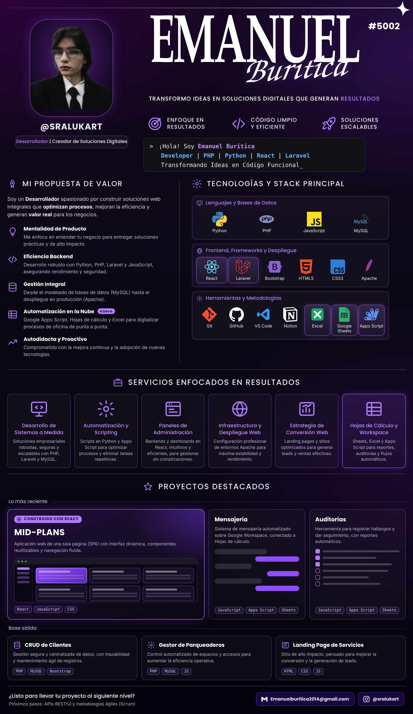

  

  

---

## 🚀 Mi Propuesta de Valor

Soy un **Desarrollador Backend y Creador de Soluciones Digitales** enfocado en transformar requerimientos complejos en herramientas eficientes, seguras y escalables. No solo escribo código; **construyo infraestructura digital que optimiza la operación de los negocios** y genera valor real.

* 💡 **Mentalidad de Producto:** Soluciones prácticas y de alto impacto orientadas a resolver problemas específicos del cliente.
* ⚙️ **Eficiencia Backend:** Creación de arquitecturas robustas utilizando **Python, PHP, Laravel y JavaScript**.
* 🔄 **Gestión Integral:** Dominio del ciclo completo, desde el modelado de bases de datos relacionales (*MySQL*) hasta la configuración y despliegue (*Apache*).
* ☁️ **Automatización en la Nube:** **Google Apps Script, Hojas de cálculo (Google Sheets) y Excel** para digitalizar procesos de oficina de punta a punta.
* 🚀 **Mejora Continua:** Autodidacta apasionado, siempre incorporando nuevas tecnologías a mi ecosistema.

---

## 🛠️ Stack Tecnológico

  <table>
    <tr>
      <td align="center" width="33%">
        <h3>💻 Lenguajes y BD</h3>
         
        
        
        
        
      </td>
      <td align="center" width="33%">
        <h3>🌐 Frontend, Frameworks y Web</h3>
         
        
        
        
        
        
        
      </td>
      <td align="center" width="33%">
        <h3>⚙️ Herramientas</h3>
         
        
        
        
        
        
        
      </td>
    </tr>
  </table>

---

## 💼 Servicios y Soluciones

* **Sistemas a Medida (PHP/Laravel/MySQL):** Desarrollo de plataformas empresariales (CRMs, herramientas internas) priorizando la integridad y seguridad de la información.
* **Automatización de Procesos (Python y Apps Script):** Creación de scripts que reducen el trabajo manual repetitivo, ahorrando tiempo y minimizando el margen de error humano.
* **Paneles de Administración:** Interfaces de backend y dashboards en React, intuitivos para que el cliente final gestione su negocio sin fricciones técnicas.
* **Desarrollo Web Orientado a Conversión:** Maquetación de *Landing Pages* con foco en rendimiento y usabilidad para maximizar la captación de prospectos y ventas.
* **Hojas de Cálculo y Google Workspace:** Sheets, Excel y Apps Script para reportes, auditorías y flujos de trabajo automáticos.

---

## 🏆 Proyectos Destacados

### 🆕 Lo más reciente

| Proyecto | Funcionalidad y Valor Aportado | Stack Principal |
| :--- | :--- | :--- |
| **⚛️ MID-PLANS** | Aplicación web de una sola página (SPA) con interfaz dinámica, componentes reutilizables y navegación fluida. **Mi proyecto insignia en React.** | `React` `JavaScript` `CSS` |
| **Mensajería** | Sistema de mensajería automatizado sobre Google Workspace, conectado a Hojas de cálculo para eliminar el envío manual. | `JavaScript` `Apps Script` `Sheets` |
| **Auditorías** | Herramienta para registrar hallazgos y dar seguimiento a auditorías, con reportes automáticos. | `JavaScript` `Apps Script` `Sheets` |

### 🧱 Base sólida

| Proyecto | Funcionalidad y Valor Aportado | Stack Principal |
| :--- | :--- | :--- |
| **CRUD de Clientes** | Sistema centralizado para la gestión segura de datos, asegurando trazabilidad y mantenimiento ágil de registros. | `PHP` `MySQL` `Bootstrap` |
| **Gestor de Parqueaderos** | Plataforma para el control automatizado de espacios y accesos. Aumenta la eficiencia operativa del negocio. | `PHP` `MySQL` `JS` |
| **Landing Page de Servicios** | Sitio web de alto impacto, estructurado estratégicamente para mejorar la tasa de conversión y generación de leads. | `HTML` `CSS` `JS` |

---

## 📈 Evolución y Próximos Pasos

Mi objetivo es entregar software de clase mundial. Sigo perfeccionando mis habilidades en:

* ⚛️ **React.js y Laravel:** Profundizando en *Single Page Applications* (SPA) y en arquitectura limpia y escalable para aplicaciones backend complejas.
* 🔗 **APIs RESTful:** Diseño e integración de servicios eficientes e intercomunicados.
* ✅ **Metodologías Ágiles (Scrum):** Para un flujo de trabajo predecible, iterativo y colaborativo.

---

## 📬 ¿Listo para llevar tu proyecto al siguiente nivel?

Si buscas un desarrollador comprometido con la excelencia técnica y el rendimiento de tu negocio, hablemos.

  
  
    
  

